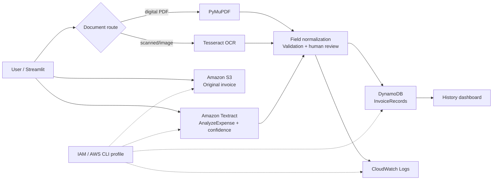

# Architecture diagram

The editable Excalidraw source is `architecture.excalidraw`. Import it at https://excalidraw.com using **Open**. It can then be exported as PNG, SVG, or PDF for the report and presentation.

