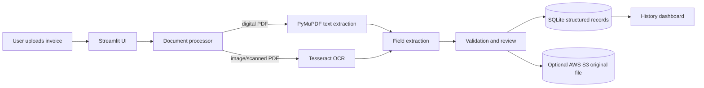

# Cloud-Based Intelligent Document Processing for Automated Invoice Extraction and Validation

## 1. Project overview

This project is a student-scale Streamlit application that accepts invoice PDFs and images, extracts useful fields, validates them, stores the result, and lets a user review past records. It supports two local extraction paths: direct text extraction for digital PDFs and optional Tesseract OCR for scanned documents/images.

## 2. Problem and motivation

Manual invoice entry is slow and error-prone. The prototype demonstrates how document processing can turn semi-structured invoices into structured records while preserving a human review step for uncertain values.

## 3. Objectives and target users

- Reduce repetitive invoice data entry.
- Extract invoice number, vendor, date, subtotal, tax, and total.
- Flag missing or numerically inconsistent values.
- Store original files and structured results for retrieval.
- Demonstrate a genuine cloud component using object storage.

Target users are small-business finance staff and students demonstrating cloud/document-processing concepts. It is not an accounting or tax system.

## 4. Functional requirements

### MVP

- Upload PDF, PNG, JPG, or JPEG files.
- Extract digital PDF text with PyMuPDF.
- Attempt OCR for images/scanned PDFs when Tesseract is installed.
- Extract the six invoice fields using explainable pattern-based rules.
- Validate required fields, date format, positive amounts, and subtotal + tax ≈ total.
- Allow review/editing before saving.
- Save records in SQLite and original documents in a configurable local folder.
- Optionally upload originals to an AWS S3 bucket and show the object key/status.
- List and retrieve previously processed records.
- Show actionable processing errors.

### Out of scope / future

Authentication, multi-tenant access control, fraud prediction, accounting-system integration, automatic payment, guaranteed support for every invoice layout, autoscaling, and production compliance certification are out of scope.

## 5. Non-functional requirements

The MVP should be understandable, reproducible on a normal laptop, use secrets from environment variables, avoid silently losing files, and provide clear validation warnings. It does not claim production availability, accuracy, or scalability.

## 6. Recommended stack

Python 3.11+, Streamlit, PyMuPDF, pytesseract (optional runtime dependency), Pillow, SQLite, boto3 (optional cloud integration), and pytest. Pattern-based extraction is preferred for an explainable undergraduate prototype. A cloud document AI API is deferred because it adds cost, provider lock-in, and uncertain free-tier requirements.

## 7. Architecture and data flow

The cloud component is S3 object storage: the original invoice is uploaded to a remote bucket when configured. Local processing and SQLite remain the development/MVP path so the application is testable without paid services. Deployment to a cloud host is optional and not required to claim that S3 is being used.

## 8. Data model

`invoices` contains: `id`, `filename`, `uploaded_at`, `invoice_number`, `vendor_name`, `invoice_date`, `subtotal`, `tax_amount`, `total_amount`, `validation_status`, `validation_messages`, `source_type`, `cloud_object_key`, and `extracted_text`.

Amounts are stored as numeric decimal strings/REAL values for this prototype. Original documents are stored under `data/uploads/` locally; the cloud copy uses a generated key under `invoices/`.

## 9. Extraction strategy

Digital PDFs are attempted first with PyMuPDF. If extracted text is empty or too short, the app requests OCR. Images always use OCR. Field extraction uses labels and regular expressions, with conservative missing-value behavior. Values are editable before persistence.

## 10. Validation and errors

Required fields are invoice number, vendor name, invoice date, and total. Dates must parse as common day/month/year or ISO formats. Amounts must be non-negative. If subtotal and tax are available, their sum must be within 0.05 of total. A warning is reported rather than blocking review. Unsupported types, unreadable files, missing Tesseract, and cloud failures are surfaced without deleting the local result.

## 11. Security and privacy

Use synthetic invoices only. Never commit `.env`, credentials, customer data, or the SQLite database. S3 credentials belong in environment variables or an IAM role; use a private bucket and least-privilege permissions. This prototype has no login and must not be presented as secure for real financial records.

## 12. Success criteria and limitations

Success means a user can process at least one digital PDF, review extracted fields, see validation output, save it, retrieve it, and demonstrate S3 upload when configured. A second scanned/image example should work when Tesseract is installed. Layout variation, OCR errors, and lack of authentication are known limitations.

## 13. Risks and work allocation

Tesseract installation and cloud credentials are the main risks; the direct-PDF path and local storage provide fallbacks. Samiksha can own UI/demo, Sambhav processing/validation, and Sahil storage/cloud/testing, with code review by all members.

## 14. Glossary

**OCR:** Optical Character Recognition. **IDP:** Intelligent Document Processing. **Object storage:** Cloud storage of files as objects in a bucket. **Bucket:** S3 container. **MVP:** Minimum viable product. **Validation:** Checks that extracted data is present and internally plausible.

## Decisions to confirm before implementation

1. Create/use an AWS S3 bucket only if the team has safe access and confirms the account will not incur unexpected charges.
2. Install Tesseract for the scanned-invoice demonstration; digital PDF processing works without it.
3. Use synthetic/sample invoices and do not upload real personal or financial data.
